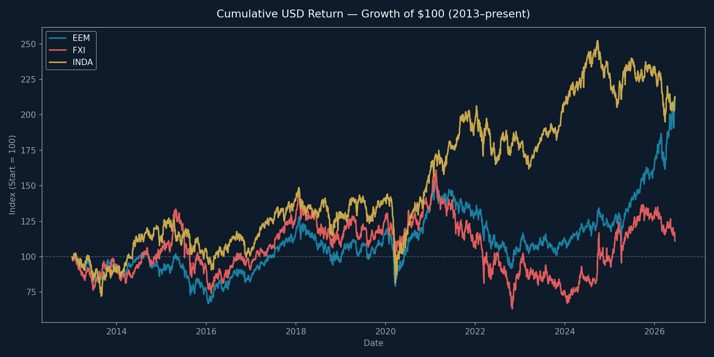
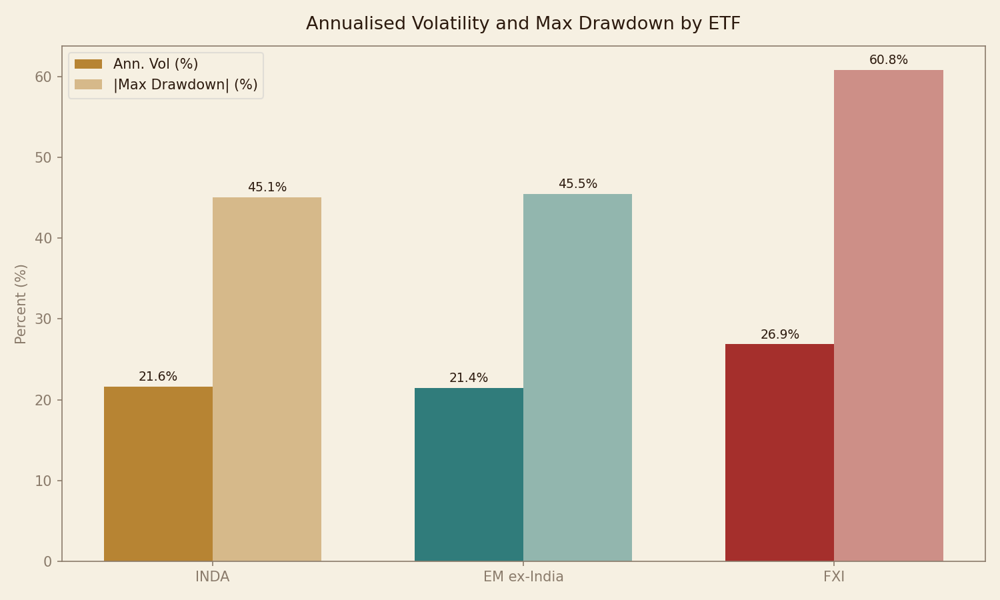
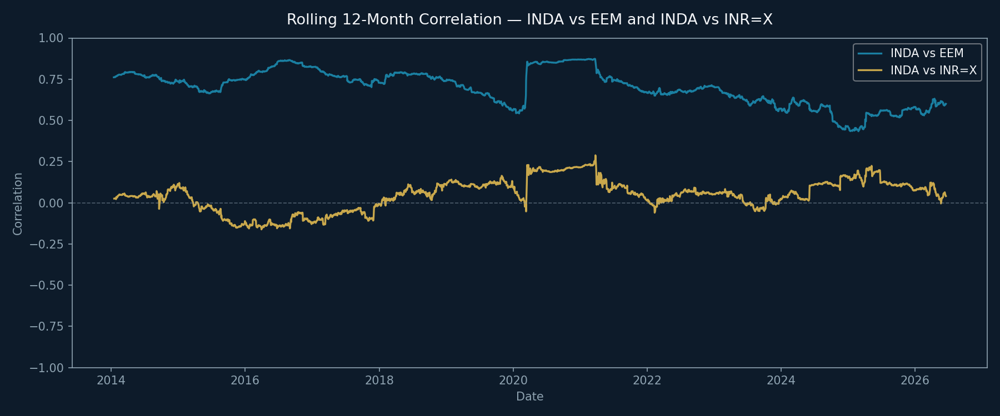
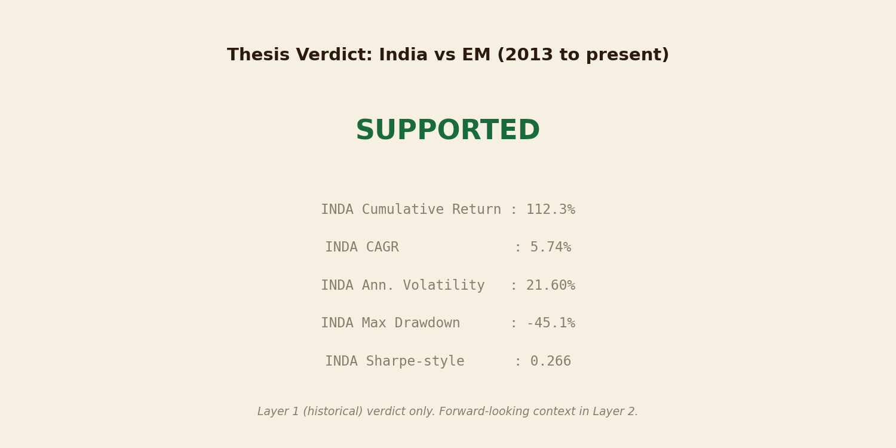

# Thesis #16 — Emerging Markets: India's Decade to Shine?

**Thesis statement:** Testing whether India delivered better risk-adjusted USD returns
than broad EM (EEM) and China (FXI) over 2013–present.

---

## Data & Method

- **Source:** Yahoo Finance via yfinance (`auto_adjust=True` — prices include dividends)
- **Instruments:** INDA (India proxy), EEM (broad EM benchmark), FXI (China benchmark), INR=X (USD/INR spot, for currency correlation only)
- **Window:** 2013-01-01 to present
- **Denominated in:** USD throughout — ETF prices are USD-quoted, so no manual conversion is needed
- **Valuation:** Treated as forward-looking context (Layer 2), not modelled in the return analysis
- **Risk-adjusted metric:** Annualised return ÷ annualised volatility (0% risk-free rate, per decision log)

---

## Summary Table

| Ticker | Cumulative Return | CAGR | Ann. Vol | Max Drawdown | Sharpe-style | Role |
| --- | --- | --- | --- | --- | --- | --- |
| EEM | 110.1% | 5.67% | 20.35% | -39.8% | 0.279 | Broad EM benchmark |
| FXI | 11.1% | 0.78% | 26.88% | -60.8% | 0.029 | China benchmark |
| INDA | 112.9% | 5.78% | 21.60% | -45.1% | 0.267 | India proxy |

---

## Verdict

### Layer 1 — Historical (what the data proves)

**PARTIALLY SUPPORTED**

INDA beat EEM on cumulative return (112.9% vs 110.1%) and beat FXI (112.9% vs 11.1%). On the Sharpe-style ratio, INDA trailed EEM (0.267 vs 0.279) and beat FXI (0.267 vs 0.029). By the pre-declared rule, this is **PARTIALLY SUPPORTED**: India beat China decisively on both measures, but could not outperform broad EM on a risk-adjusted basis — it returned slightly more while also being slightly more volatile.

### Layer 2 — Forward-looking (context, not proven by the data)

The historical return window cannot prove the *next* decade thesis. Three forward-looking signals add caution:

1. **Valuation ambiguity:** Trailing P/E shows only a ~7.5% India premium over EEM (India ~21x, EM ~20x), while forward P/E implies a ~55–70% premium. The two measures disagree significantly; neither can be dismissed.
2. **Currency risk:** The rupee (INR) has depreciated against the USD over the full window. USD-denominated investors bear this cost; it is visible directly in the INR=X series, which rose from ~55 to ~95 rupees per dollar over the window.
3. **2026 oil shock:** Crude above $100/bbl (Middle East conflict) hit India hard — ~10% YTD drawdown, $20B+ in foreign outflows. India imports ~85% of its crude. This is a known structural vulnerability, treated here as a stress-test scenario rather than a permanent re-rating.

Likely forward verdict: **historically supported, forward-looking uncertain.**

---

## Notable Finding

Rolling 12-month INDA–EEM correlation averaged ~0.76 over the full window. India moves closely with the broad EM herd, which weakens the diversification argument sometimes made for an India-only allocation.

---

## Charts

